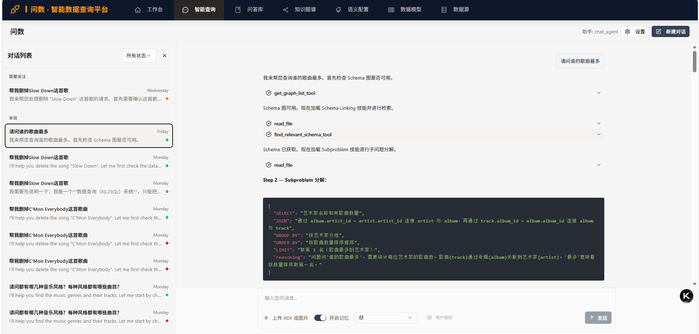
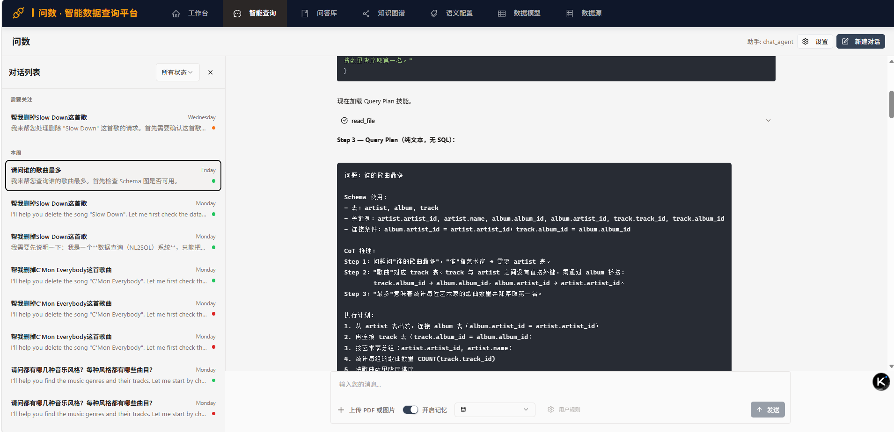
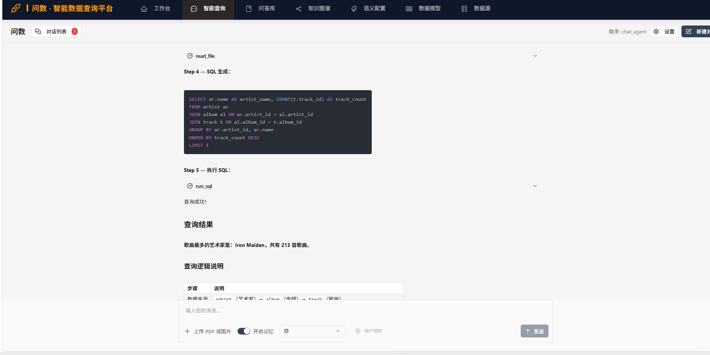
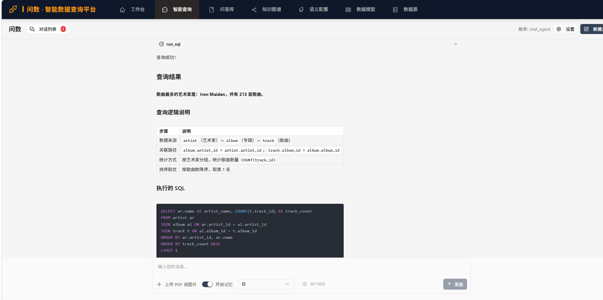
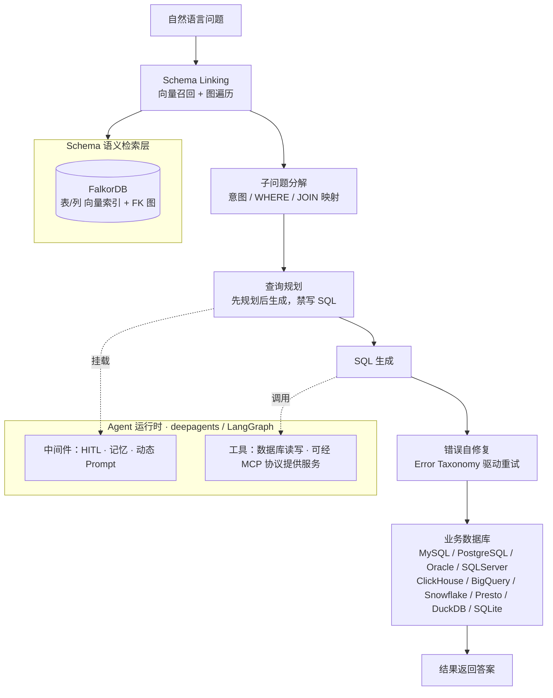

# AskSQL · 智能数据查询平台

NL2SQL 系统：用自然语言提问，Agent 自动完成 Schema 检索、查询规划、SQL 生成与错误自修复，并执行返回结果。

## 界面

| 提问：Schema 检索 + 子问题拆解 | 规划：只出步骤，不写 SQL |
| :---: | :---: |
|  |  |

| SQL 生成与运行 | 查询结果 |
| :---: | :---: |
|  |  |
## 架构



## 核心设计

- **五级流水线**：将 NL2SQL 拆成 Schema Linking → 子问题分解 → 查询规划 → SQL 生成 → 错误自修复五个专职步骤；查询规划阶段只输出程序化步骤、禁写 SQL，用分阶段约束抑制幻觉，改善多表 JOIN 与嵌套聚合类复杂查询。
- **Schema 混合检索**：数据库元数据（表/列/主外键）入图数据库，构建向量索引 + 外键关系图；检索时先向量召回相关表列，再图遍历补齐 JOIN 桥接表，解决大 Schema 下的上下文裁剪。
- **中间件体系**：基于 LangGraph 自定义中间件挂载 HITL 人工确认、记忆注入与动态 Prompt 组装；Agent 具备虚拟文件系统（skills / workspace）与 shell 执行环境。
- **工具双模式**：操作数据库的工具既可本地直连调用，也可通过 MCP 协议以标准服务形式对外提供，两种模式可切换。
- **错误自修复**：SQL 执行失败时，按 9 大类 31 小类错误分类法（syntax / schema_link / join / filter / aggregation / value / subquery / set_ops / other）定位根因，走「诊断 → 修正计划 → 重写 SQL → 重执行」循环，最多 3 轮；同一错误码连续出现两次即判定「卡住」并终止。
## 技术栈

FastAPI · deepagents/LangGraph · FalkorDB· SQLAlchemy/PostgreSQL · MCP(fastmcp) · React18+TS+Vite+Tailwind+Sigma.js。

## Quick Start

前置依赖：

- Python ≥ 3.13，推荐使用 [uv](https://docs.astral.sh/uv/) 管理环境
- 可访问的 LLM API Key（写入根目录 `.env` 的 `LLM_API_KEY`）
- FalkorDB 与 Redis 服务（Schema 图存储与记忆存储）

启动后端：

```bash
uv sync                          # 安装依赖
python start_api.py              # 默认 0.0.0.0:8065，可用 --port 指定
```

启动前端（可选）：

```bash
cd ui
npm install
npm run dev
```

## 测试

```bash
uv run pytest tests/ -v   # 运行全部单元测试（方言规则 / SQL 审核 / 引擎注册表 / 召回去重）
```
